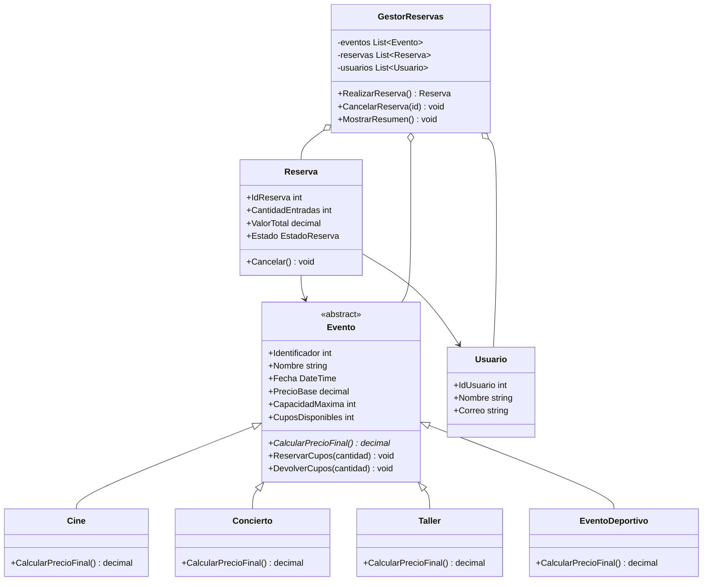

# PLANAZO - Gestión de eventos y reservas

## Descripción

PLANAZO es una aplicación de consola desarrollada en C# y .NET para consultar eventos, reservar entradas, controlar cupos disponibles y cancelar reservas.

## Funcionalidades

- Listar eventos y consultar un evento por su identificador.
- Reservar entradas y calcular el precio según el tipo de evento.
- Controlar la disponibilidad antes de confirmar una reserva.
- Consultar reservas, cancelarlas y devolver los cupos.
- Mostrar un resumen de las reservas activas.
- Consultar las reservas realizadas por el correo de un usuario.
- Manejar errores sin cerrar inesperadamente el programa.

## Requisitos

- .NET 8 SDK o una versión compatible.
- Terminal o editor como Visual Studio o Visual Studio Code.

## Cómo ejecutar

Desde la carpeta donde se encuentra `PLANAZO-POO-CSharp.csproj`, ejecutar:

```bash
dotnet run
```

## Clases y relaciones

- `Evento`: clase abstracta que contiene los datos comunes, protege sus propiedades y define `CalcularPrecioFinal()`.
- `Cine`, `Concierto`, `Taller` y `EventoDeportivo`: heredan de `Evento` y sobrescriben `CalcularPrecioFinal()`.
- `Usuario`: representa a la persona que realiza reservas y se identifica por su correo.
- `Reserva`: relaciona un `Usuario` con un `Evento`; conserva cantidad, valor total y estado.
- `GestorReservas`: mantiene colecciones `List<Evento>`, `List<Reserva>` y `List<Usuario>`, y controla las operaciones del sistema.
- `Program`: muestra el menú, lee las opciones y llama al gestor.

## Conceptos de POO utilizados

### Encapsulamiento

Los atributos se exponen mediante propiedades con `private set`, de modo que no se puedan modificar libremente desde otras clases. Los cupos cambian por medio de `ReservarCupos()` y `DevolverCupos()`, que validan las cantidades.

### Abstracción

`Evento` es abstracta porque representa lo común a todos los eventos, pero no define por sí sola una regla de precio concreta. También declara el método abstracto `CalcularPrecioFinal()`.

### Herencia

`Cine`, `Concierto`, `Taller` y `EventoDeportivo` reutilizan los datos y las operaciones de `Evento`, y cada uno establece su regla de precio.

### Polimorfismo

El gestor guarda los eventos en una colección de tipo `List<Evento>`. Al llamar a `CalcularPrecioFinal()`, C# ejecuta la versión correspondiente al tipo real del objeto:
- Cine: conserva el precio base.
- Concierto: aumenta el precio base un 15 %.
- Taller: descuenta el 10 %.
- Evento deportivo: aumenta el precio base un 20 %.

### Constructores

Los constructores inicializan los objetos y validan los datos básicos antes de asignarlos.

### Composición y asociaciones

Una `Reserva` está asociada con un `Usuario` y un `Evento`. `GestorReservas` administra las colecciones de eventos, usuarios y reservas.

### Colecciones

Se utiliza `List<T>` para guardar eventos, usuarios y reservas durante la ejecución.

### Excepciones

Se lanzan excepciones cuando se ingresan cantidades inválidas, se consulta un evento inexistente, no hay cupos suficientes o se intenta cancelar una reserva ya cancelada. `Program` captura los errores y permite seguir utilizando el menú.

## Pruebas que se deben realizar

1. Crear una reserva válida.
2. Intentar reservar más entradas que los cupos disponibles.
3. Ingresar una cantidad negativa o cero.
4. Cancelar una reserva y volver a consultar los cupos.
5. Intentar cancelar de nuevo la misma reserva.
6. Consultar un identificador de evento inexistente.
7. Comparar los precios de cine, concierto, taller y evento deportivo.
8. Consultar las reservas de un usuario por correo.
9. Verificar que el resumen solo cuente las reservas activas.

## Diagrama de clases UML



## Pregunta de sustentación

Utilicé una clase abstracta `Evento` porque todos los eventos tienen datos en común, como identificador, nombre, fecha, precio y cupos disponibles. En vez de repetir esos datos y sus validaciones en `Cine`, `Concierto` y `Taller`, los definí una sola vez en la clase base.

Además, `CalcularPrecioFinal()` se declara como abstracto para que cada tipo de evento aplique su propia regla. Por ejemplo, `Cine` conserva el precio base, `Concierto` le suma el 15 % y `Taller` aplica un descuento del 10 %. Si se agrega `EventoDeportivo`, basta con heredar de `Evento` y sobrescribir ese método, sin modificar las reglas de las clases existentes. Así el código queda más organizado y es más fácil de ampliar.

## Capturas de pantalla

Guarda las capturas de las pruebas realizadas dentro de la carpeta `Capturas/` y agrégalas aquí. Ejemplo:

- `Capturas/01-eventos-disponibles.png`
- `Capturas/02-reserva-valida.png`
- `Capturas/03-error-cupos.png`
- `Capturas/04-cancelacion.png`
- `Capturas/05-resumen.png`

Las capturas deben corresponder a ejecuciones reales del programa.
